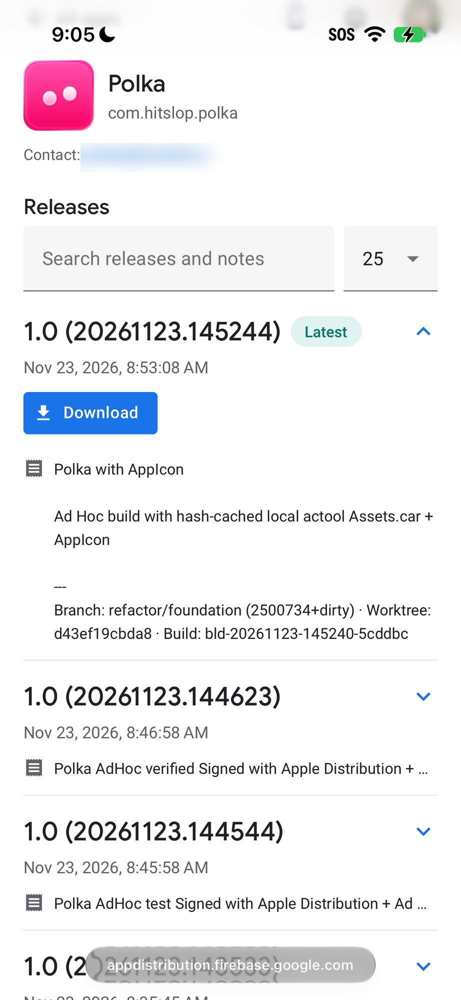
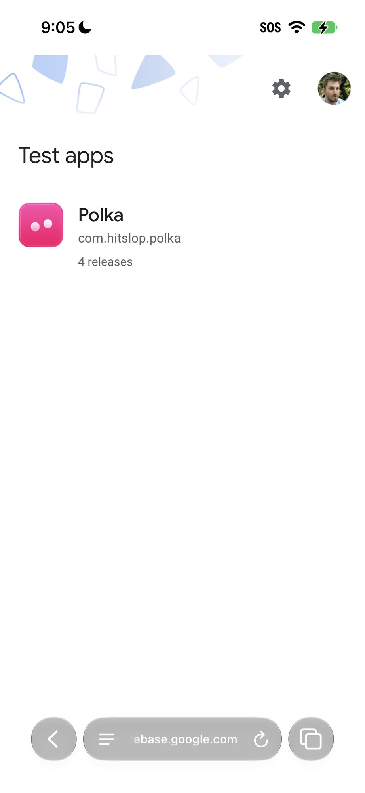
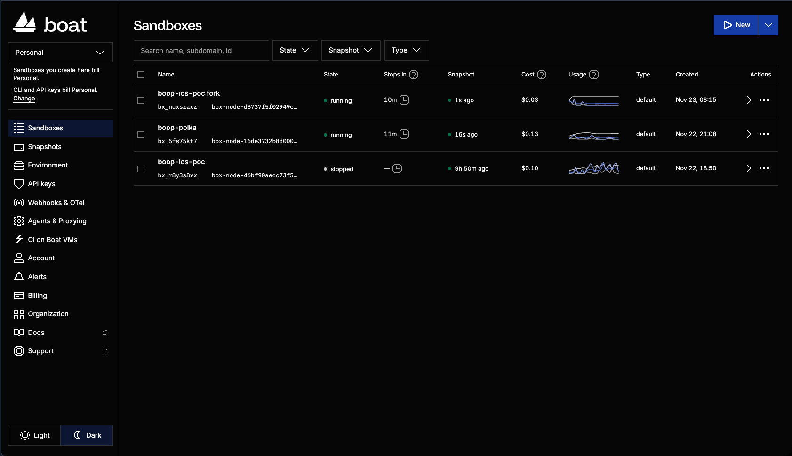
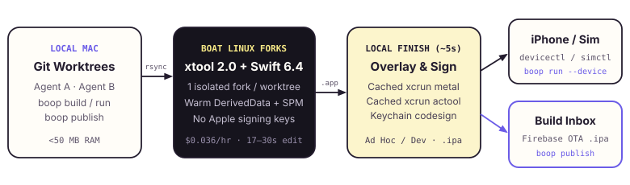

# Boop (`boop`)

**Build over there. Run right here.**

Boop is a local-first Rust CLI that offloads heavy iOS SwiftUI and Rust builds off your Mac onto cheap remote Linux VMs (**[Boat.dev](https://boat.dev)** or any SSH-reachable Ubuntu box), pulls the unsigned `.app` back over delta `rsync`, compiles local `.metal` shaders and asset catalogs / `.icon` app icons via hash-cached `xcrun metal` & `xcrun actool` (`<5ms` warm), signs locally with your macOS Keychain (**zero Apple credentials ever leave your Mac**), and either:

- **Deploys straight to your plugged-in iPhone or Simulator** (`boop run --device`), or
- **Publishes an untethered Ad Hoc OTA build to Firebase App Distribution** (`boop publish --name "..." --notes "..."`) — turning Firebase App Tester into an **iPhone Build Inbox** for parallel coding agents across Git worktrees.

<p align="center">
  
  &nbsp;&nbsp;&nbsp;
  
</p>

<p align="center">
  
</p>

---

## Why Boop?

Parallel AI coding agents (Claude Code, Codex, Antigravity) across Git worktrees work great for web and Rust — until you build native iOS. Two or three concurrent `xcodebuild` runs exhaust an 8–16 GB MacBook and send load averages through the roof.

Boop splits the pipeline cleanly (**local brain, remote muscle** — no Claude/Codex or Apple credentials ever run on the Linux VM):

1. **Local Mac (`<50 MB` RAM for `boop`):** Your coding agents (Claude Code, Codex, Antigravity, Rex/Herdr panes) edit files locally in Git worktrees and invoke `boop build --json` or `boop publish --json`. Boop syncs changed files, overlays hash-cached local Metal shaders + `Assets.car` / `AppIcon`, signs with macOS Keychain + CMS-verified provisioning profiles, and installs via `xcrun devicectl`, `xcrun simctl`, or `firebase appdistribution:distribute`.
2. **Remote Linux worker (`xtool 2.0` + Swift 6.4):** Handles the heavy Swift/Clang compilation and linking in isolated per-worktree directories or forked Boat sandboxes — keeping multi-gigabyte `DerivedData` and 6–12 GB compiler RAM spikes completely off your Mac.

<p align="center">
  
</p>

---

## Benchmarks (Polka — 37 SwiftPM packages, Firebase, GRDB, Metal shaders)

Measured on a 16 GB Apple M1 Mac vs. Boat.dev's **4 vCPU / 8 GB `default` VM (`$0.036/hr`)**:

| Workflow | Local M1 Xcode | `boop run --device` (Boat 4 vCPU) |
| :--- | :--- | :--- |
| Clean compile (warm SPM cache) | `8m 14s` (`494.45s`) | **`3m 38s`** (`218.04s`) — **2.27× faster** |
| 1-line SwiftUI edit — compile | `49.58s` | **`27.24s`** — **1.82× faster** |
| 1-line SwiftUI edit — end-to-end → iPhone | `57.18s` | **`37.53s`** (`1.7s` sync · `27.2s` build · `2.5s` pull · `1.7s` sign · `4.1s` install) |
| Local Mac compile RAM | 6–12 GB | **`<50 MB`** |
| Compute cost / incremental run | — | **`~$0.0004`** (under 1/20th of a cent) |

### Fork-per-Worktree Pool

Measured with three Boat `default` forks (4 vCPU, 8 GB each). Each worktree leases its own fork cloned from a warmed base snapshot:

| Operation | Fork to SSH | Disk hydration | Remote build | Wall |
| :--- | ---: | ---: | ---: | ---: |
| Clean base warm (populated SwiftPM cache) | — | 0.3 s | 228.9 s | 256.2 s |
| First build on a fresh fork (unchanged) | 23.5 s | 192.2 s | 31.3 s | 256.8 s |
| Next 1-line edit on that leased fork | — | — | 16.8 s | 23.5 s |
| Two simultaneous edits on distinct forks | — | — | 13.2 s / 28.4 s | 20.1 s / 36.4 s |

Concurrent builds overlapped for 12.7 s with >5.1 GiB RAM free on each worker and zero local Mac compile load.

---

## Installation

```bash
git clone https://github.com/hitSlop/boop.git
cd boop
cargo build --release
mkdir -p ~/.local/bin
ln -sf "$(pwd)/target/release/boop" ~/.local/bin/boop
```

Ensure `~/.local/bin` is on your `PATH`.

### Local Prerequisites (macOS)
- **Xcode** (with `xcrun devicectl`, `xcrun metal`, `xcrun actool`, `codesign`, and `security`)
- **Signing:** A valid `Apple Development` identity in Keychain + matching `.mobileprovision` in `~/Library/Developer/Xcode/UserData/Provisioning Profiles/` (plus an `Apple Distribution` cert + Ad Hoc `.mobileprovision` for `boop publish` OTA installs)
- **Worker backend (pick one):**
  - **Boat.dev:** `boat` CLI (`curl -fsSL https://boat.dev/install | sh && boat login`)
  - **Any Ubuntu `x86_64` SSH server** (Hetzner, DigitalOcean, EC2, home lab) with passwordless `sudo` and SSH key access
- **Optional (for `boop publish`):** `firebase` CLI (`brew install firebase-cli && firebase login`)

---

## Quick Start

### 1. Initialize a Project

Inside your iOS (`.xcodeproj`, `project.yml`, or `Package.swift`) or Rust project root:

```bash
# Option A: Create & bootstrap a new Boat.dev Linux sandbox
# (installs Swift 6.4, xtool 2.0, shims, and uploads a slim Darwin SDK from your local Xcode.app):
boop init --provider boat --machine-type default --bootstrap

# Option B: Bind an existing Boat sandbox:
boop init --boat-id bx_xxxxxxxx

# Option C: Bind any Ubuntu x86_64 SSH host (no Boat account required):
boop init --provider ssh --ssh-host ubuntu@your-server-ip --ssh-port 22 --ssh-key ~/.ssh/id_ed25519 --bootstrap
```

`boop init` writes:
- `.boop.toml` in the project root (safe to commit — contains **zero** secrets)
- `~/.config/boop/config.toml` for your global worker definitions

### 2. Verify Health

```bash
boop doctor
```

Checks local Xcode, Keychain signing identities, paired physical devices, Development & Ad Hoc provisioning profiles, Firebase CLI auth, remote worker state, and remote Swift/`xtool`/SDK status.

### 3. Build & Deploy to iPhone or Simulator

```bash
boop run --device                 # Build remotely, overlay Metal & AppIcon, sign locally, launch on iPhone
boop run --device "My iPhone"     # Target a specific paired device by name or UDID
boop run --simulator              # Cross-compile for arm64-apple-ios-simulator, ad-hoc sign & launch
boop build                        # Remote build + pull .app only (no install)
boop run --device --config release
boop run --device --json          # Structured JSON output for coding agents
```

### 4. Publish Untethered OTA Builds (Firebase Build Inbox)

```bash
boop publish \
  --name "New keyboard animation" \
  --notes "Spring transition and haptic tuning"

# Re-sign, package, and upload the already-pulled .app without rebuilding remotely:
boop publish --no-build --name "Quick OTA re-publish"

# Inspect published and named builds across all worktrees:
boop builds
boop builds --json
```

`boop publish` automatically:
1. Compiles remotely on Linux (`debug` by default to reuse warm caches; pass `--config release` for Release).
2. Delta-pulls `.app` locally, compiles hash-cached `.metal` shaders and `[assets]` (`Assets.car` + `AppIcon`), and stamps a unique sortable `CFBundleVersion` into `.app/Info.plist` without dirtying Git.
3. Signs locally via macOS Keychain (`auto` prefers an Ad Hoc distribution profile and falls back to Development).
4. Packages a clean `Payload/<App>.app` `.ipa` via `ditto --norsrc` and uploads via `firebase appdistribution:distribute`.
5. Saves a build record (`build_id`, `testing_uri`, `branch`, `commit`, `worktree_id`, `ipa_path`) under `~/.local/state/boop/builds/`.

### 5. Run Remote Commands & Manage Compute Cost

```bash
boop exec -- swift test --package-path Packages/MyCore
boop status     # Live worker state, Boat runtime/spend, and recent jobs
boop stop       # Pause Boat VM ($0/hr compute billing; preserves disk & all build caches)
```

---

## Parallel Git Worktrees (Fork Pool)

Add `[workers.default.pool]` to a Boat worker in `~/.config/boop/config.toml`:

```toml
[workers.default.pool]
max_forks = 3
```

Run `boop pool warm --json` once from your main checkout to build and snapshot the warmed base. Each Git worktree then automatically leases its own isolated fork:

```bash
git worktree add ../myapp-feature -b feat/new-ui
cd ../myapp-feature
cp ../myapp/.boop.toml .boop.toml   # if untracked
xcodegen generate                   # for XcodeGen projects
boop build --json
boop publish --name "New UI" --notes "Ready for phone review" --json
boop release --json                 # reclaim the fork when done
```

| Command | Effect |
| :--- | :--- |
| `boop pool status` | Show base, fork IDs, state, lease paths, fork ages, and last jobs. |
| `boop release` | Delete the idle fork leased to the current worktree. |
| `boop pool gc` | Reclaim owned forks whose worktree paths were removed. |
| `boop stop` | Pause the base and idle forks (`$0/hr`). |

---

## Configuration Reference

### Project `.boop.toml`

```toml
[project]
name = "MyApp"
engine = "xtool"               # "xtool" (iOS Xcode/SwiftPM) or "cargo" (Rust)
scheme = "MyApp"               # Xcode scheme (for .xcodeproj projects)
app_name = "MyApp"             # Output .app name without extension
bundle_id = "com.example.myapp"
team_id = "TEAM123456"
worker = "default"             # Worker name from ~/.config/boop/config.toml
default_device = "My iPhone"   # Optional default physical device name/UDID
compilation_cache = false      # Experimental SwiftBuild CAS (keep false by default)

[sync]
exclude = ["build/", "docs/"]

[signing]
mode = "local-macos"           # "local-macos" (zero cloud creds) or "none"
disable_remote_codesign = true # Disables remote signing in remote pbxproj copy only

[[metal.bundles]]
source_dir = "Packages/AppUI/Sources/Design/Shaders"
target_bundle = "AppUI_Design.bundle"
copy_sources = true

[assets]
sources = ["Apps/MyApp/Resources/AppIcon.icon"] # Compiled locally via hash-cached `xcrun actool`
app_icon = "AppIcon"
include_all_app_icons = false

[distribution.firebase]
app_id = "1:000000000000:ios:abcdef0123456789" # Auto-detected from GoogleService-Info.plist if omitted
groups = ["personal-testers"]
signing_profile = "auto"                        # "auto" | "adhoc" | "development"
```

### Global `~/.config/boop/config.toml`

```toml
default_worker = "default"

[workers.default]
provider = "boat"
sandbox_id = "bx_xxxxxxxx"
machine_type = "default"       # small | default | large | xlarge
hourly_rate_usd = 0.036

[workers.hetzner]
provider = "ssh"
host = "203.0.113.10"
user = "ubuntu"
port = 22
ssh_key = "/Users/you/.ssh/id_ed25519"
```

---

## Security Model

- **Zero Apple secrets on remote workers:** Boop hard-excludes `.env*`, `*.p8`, `*.p12`, `*.pem`, `*.key`, `*.mobileprovision`, and SSH keys from `rsync`. All `codesign` operations run locally on macOS using your Keychain.
- **No silent fallback to local `xcodebuild`:** Remote compiler errors return structured diagnostics directly so coding agents never accidentally trigger heavy local Xcode builds.

## What Works & Current Limitations

| Capability | Status |
| :--- | :--- |
| SwiftUI / UIKit iOS apps (`.xcodeproj`, XcodeGen, SwiftPM, Firebase, GRDB, etc.) | Supported |
| Local Metal shaders (`.metal` → `default.metallib`) & Asset Catalogs / `.icon` (`Assets.car` + `AppIcon`) | Supported (hash-cached locally on macOS) |
| Physical iPhone (`devicectl`), iOS Simulator (`simctl`), Firebase App Distribution OTA (`boop publish`) | Supported |
| Linux-compatible SwiftPM unit tests (`boop exec -- swift test`) | Supported |
| Hosted `XCTest` / `XCUITest`, SwiftUI Canvas Previews, Xcode Instruments | Still requires local macOS Xcode |
| Remote worker OS / arch | Ubuntu Linux (`x86_64` tested; `arm64` supported by `xtool`) |

## Credits & Upstream

Built on top of **[xtool](https://github.com/xtool-org/xtool)** (v2 / SwiftBuild on Linux). Fixes discovered while building Boop were contributed back in [xtool-org/xtool#464](https://github.com/xtool-org/xtool/pull/464).

For AI coding agent instructions (Claude Code, Codex, Antigravity), see [AGENTS.md](AGENTS.md).

### Rex Terminal Integration (Optional)

If you use **[Rex](https://rex.sh)**, load [contrib/rex/boop.lua](contrib/rex/boop.lua) from `~/.config/rex/config.lua` for native Command Palette actions (`Boop: Publish OTA Build…`, `Boop: Build Inbox`, `Boop: New Agent Worktree…`, and `Boop: Pool Status & Stop`):

```lua
dofile("/path/to/boop/contrib/rex/boop.lua")
```

## License

[MIT](LICENSE) © 2026 hitSlop Labs
